# Auras - setting up HoT and Debuff Icons

Due to Blizzard's addon changes for Midnight and Forever, the old debuff, HoT, and HoT bars tabs are no more.
Instead, there's the new Aura system. This combines Buff and Debuff settings.

This will be a (hopefully) quick guide on how this system works and how to set up your things. If you have any questions or something is unclear, feel free to open an issue on GitHub, or join the VuhDo Discord.

## Table Of Contents <!-- omit in toc -->
- [TL:DR - Where'd all my HoT/Debuff settings go?](#tldr---whered-all-my-hotdebuff-settings-go)
- [Which Auras to track: Auras → Groups](#which-auras-to-track-auras--groups)
  - [List-Type Auras: Add individual Spells/HoTs](#list-type-auras-add-individual-spellshots)
  - [Filter-Type Aura Groups](#filter-type-aura-groups)
  - [Bar Colors (Custom, Dispel, Glow)](#bar-colors-custom-dispel-glow)
- [How Auras get displayed: Panels → Auras](#how-auras-get-displayed-panels--auras)
  - [Aura Icon Setup](#aura-icon-setup)
  - [Aura Bar Setup](#aura-bar-setup)
- [Global Defaults: Colors → Auras](#global-defaults-colors--auras)
- [What about ignoring spells?](#what-about-ignoring-spells)
- [What is that Panels → Private Auras tab?](#what-is-that-panels--private-auras-tab)
- [What about Bouquets?](#what-about-bouquets)

## TL:DR - Where'd all my HoT/Debuff settings go?

<u>The way you set up Auras:</u>
- Create a Group in [Auras → Groups](#which-auras-to-track-auras--groups)
- Choose where and how your Aura Groups show up in [Panels → Auras](#how-auras-get-displayed-panels--auras) using different Anchors. 

The default Aura Groups can't be edited, but you can make copies of them and edit those. Make sure to also update the corresponding anchor in Panels → Auras

<u>**There's two types of Aura Groups:**</u>

<u>List:</u> Add Auras you want to track by name or SpellID. You can track Buffs on friendly units, and Debuffs on hostile units.

<u>Filter:</u> Use filter conditions to show Groups of Auras. The filters are controlled by Blizzard, the tooltips should give you a general idea of what Blizz says is in there.

<!--Some common setup examples can be found at [the very bottom](#common-setup-examples--special-cases) of this guide.
Maybe later.
-->

## Which Auras to track: Auras → Groups

 **None of the premade Groups can be edited**. 
 To still customize them, select the Aura Group you'd like to use as a base, then click "Copy".  This will copy all settings from the original, but make them editable. You may also give this group a new name. Per default, a newly copied Aura Group will have the same name as the old one, only with the suffix `(Copy)` added.

### List-Type Auras: Add individual Spells/HoTs

First off: Because of Blizzard's restrictions, this only works for Buffs on friendly, and Debuffs on hostile units. For debuffs on your party, you'll have to use a [Filter-Type Aura](#filter-type-auras).

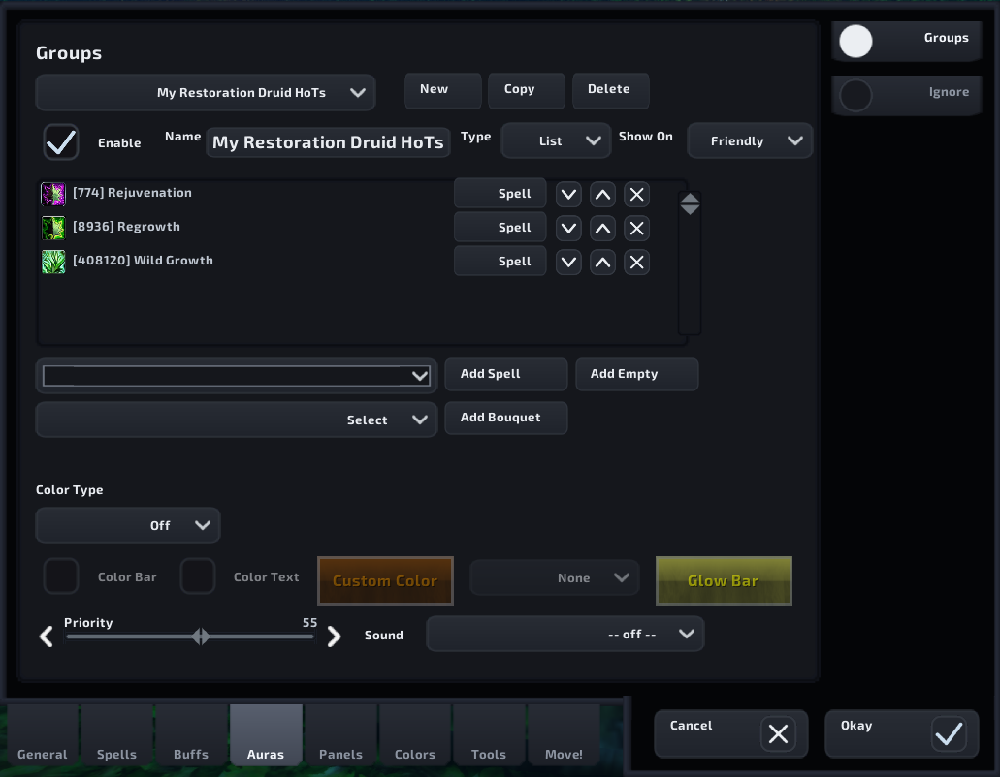

This is a copy of the default `Restoration Druid HoTs` Group in WoW Forever I've created using the `Copy` Button. (This works the same in Retail, too.)

Above the spell list, to the right you can see the dropdowns for `Type` and `Show On`. `Type` switches the Aura Group between being a Filter-Type or List-Type Aura. `Show On` decides if this Aura Group and its colors, when anchored, should only show up on friendly units, hostile units, or on both. See [Filter-Type Aura Groups](#filter-type-aura-groups) for a default-profile example.

Auras will show up on your [Anchors](#how-auras-get-displayed-panels--auras) in the order you pick here. The first spell in the list will show up in the first position of your anchor. 

You can reorder them using the arrow buttons in the list, or remove them using the X button.

Select a spell you'd like to add from the dropdown menu, or type in its name, then click `Add Spell` to add it to the list. `Add Empty` adds an empty space between Icons on your anchor, which can be useful for [Aura bars](#aura-bar-setup), for example. Additionally, you can add Bouquets from its respective dropdown.

In addition to this, you can see a `Spell` Button in each added Aura's row. This is used to control how individual icons show up.

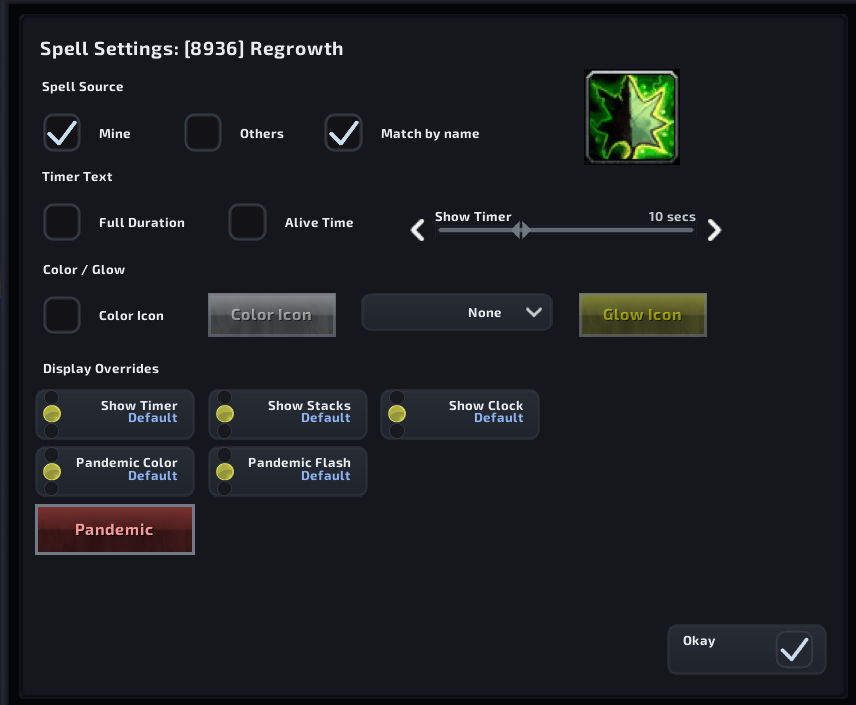

At the top, you can configure whether you'd like to see this aura when it's applied by you, others, or both. Because of spell ranks, in Forever, there's also a checkbox to always match an aura by name instead of Spell ID, so you don't have to change your Aura Groups every time you learn a new spell. It's checked by default, so you don't have to worry about it usually.

The `Timer Text` section lets you choose if you'd like to see the timer text for this Aura for its full duration, or have it count up instead of down. 

With the `Show Timer` slider, you control from which point on it starts counting down, if neither other option is selected.

You can also choose a color overlay to put on this Aura via `Color Icon`. This will be especially important for [Aura Bars](#aura-bar-setup) later, since it allows you to make different colored Aura Bars. You may also choose a `Glow Icon` effect to show around your icon and customize its color. You can preview both options on the icon as you go.

Below, under `Display Overrides` you can see overrides for the tri-state buttons in [Panels → Auras](#how-auras-get-displayed-panels--auras) and set up how you'd like your Aura icon to behave in its Pandemic window (at about 3-4 seconds left).
The color selection for the `Pandemic Color` allows you to override the default one set in [Colors → Auras](#global-defaults-colors--auras). 
Pandemic settings are Retail-only, since Pandemic windows aren't a thing in Forever, so Blizzard didn't include this options for addons in Forever.

### Filter-Type Aura Groups

**Disclaimer: Some of the filter conditions here apply mostly to Retail. In Forever, Blizzard doesn't seem to be too interested in categorizing Auras, so the `Boss/Role/Raid/Important/Priority`-categories might not be very useful. `Dispellable/All Dispellable/From Me/Can Apply` should work as expected. Blizzard controls what's in each category.** 

Filter-Type Aura Groups use filters to show groups of spells (i.e. Big Defensives, All Debuffs, All Buffs). Blizzard determines what's in each filter, addons can't add or remove individual spells (→ Blacklisting Debuffs on friendly units is no longer possible, see [the section on ignore lists](#what-about-ignoring-spells).)

You'll likely mostly use them for debuffs on friendly units, so I'll use a copy of `All Debuffs` to demonstrate.

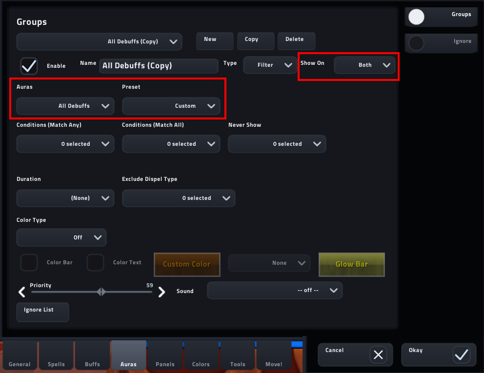

With `Show On`, you can choose if you'd like this group to show up on the frames of friendly, hostile, or both types of units later. (Keep in mind that you will still need to add it to an anchor later either way.)

The default profile's second panel (Private Tanks and Bosses) uses two aura anchors with the same position and icon style. One anchor is scoped only to friendlies and shows `Relevant Debuffs` (debuffs on private tanks you may need to heal). The other is scoped only to hostiles and shows `My Debuffs` (your DoTs on boss frames).

In `Auras`, you can choose whether you'd like to show debuffs or buffs in this group. 
With the `Presets` dropdown, you can decide if you'd like to base your group off an existing Aura Group, or make a custom one.  Using a preset, then making changes to it, will change this to say "Custom", but keep your settings from the preset.

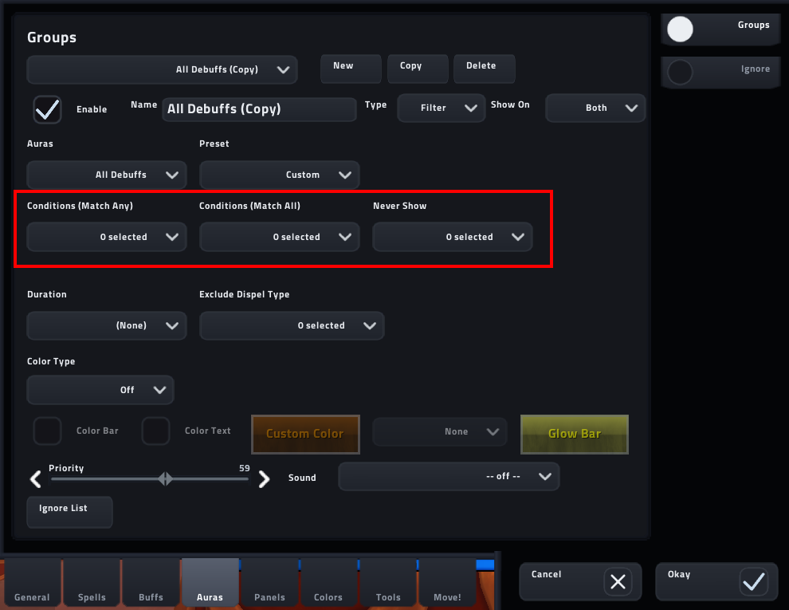

Now for the conditions. The options are `Match Any`, `Match All` and `Never Show`.

**Match Any:** In order to be shown, a debuff needs to match *any* of the conditions you select here. I.e. if you select "Dispellable" and "CC Effect" here:
- A debuff you can dispel will show up
- A CC Effect you can't dispel will also show up

You can select up to 5 conditions here.

**Match All:** In order to be shown, a debuff needs to fit *all* of the conditions you select. If you select "Dispellable" and "CC Effects" here, only CC Effects that you can *also* dispel will show up.

**Never Show:** Any debuff matching the conditions you select here will be hidden.
Selecting "Dispellable" here will only make the Aura Group show debuffs you *cannot* dispel.

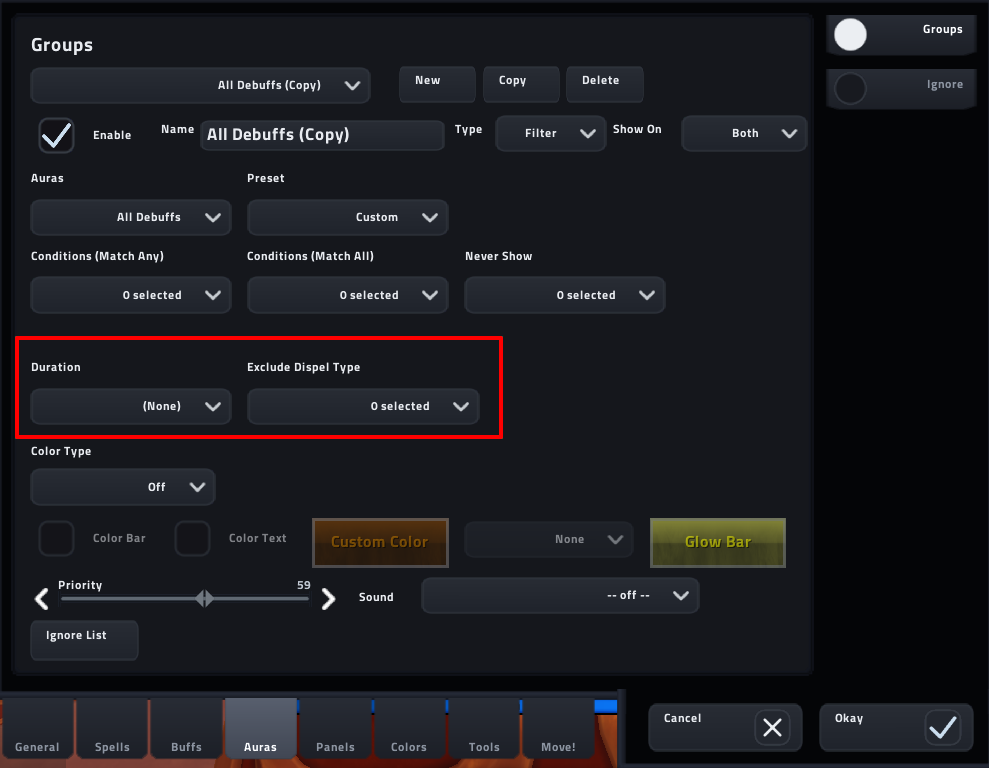

The last two filtering options are `Duration` and `Exclude Dispel Type`.

For `Duration`, you can set up your Aura Group to only show up when their total duration is less than a certain amount of time, or, by selecting `Has Duration`, you can hide debuffs with an infinite duration. (Careful: Doing so will hide some things, i.e. the stacks on Twin Fangs in The Venomous Abyss)

With `Exclude Dispel Type`, you can, for example, hide Bleeds specifically, if you don't want to see them.

### Bar Colors (Custom, Dispel, Glow)

Changing the Color settings of an Aura Group applies the colors **regardless** of whether or not the Aura Group is anchored to any Panels (Anchors will be explained [here](#how-Auras-get-displayed-panels--Auras)). This is useful for when you want your frames to turn certain colors, but not show any icons.

*Note that the main default Aura Group a lot of people will be using to track Debuffs, **"Dispellable Debuffs", already has its bar colors configured** to the "Dispel"-colors, so **you won't need to do this manually.***

The choices for color types are `Custom`, `My Dispels` and `All Dispels`. Additionally, you can configure a bar glow, or a sound that plays, when any of the Auras in this Group are applied.

**<u>Custom:</u>** You may set a custom color for when **any** of the Auras in this Group are active on the player. You can click the example bar shown to change the Colors for both Text and the bar itself for this Aura Group. 
 
**<u>My Dispels:</u>** This shows the colors configured in Colors → States when an aura **you can dispel or purge** is active.

**<u>All Dispels:</u>** This uses the colors configured in Colors → States when an aura **that can be dispelled/purged, no matter if your class can dispel/purge it** is active. Make sure you use this on a group that isn't limited to auras only you can dispel/purge.
 
The priority slider controls which Aura Group's color settings take precedence over other Aura Groups. The lower the number, the higher the priority.

Example:
- Aura Group 1 has debuff colors enabled and a priority of 50
- Aura Group 2 has custom colors enabled and a priority of 10

When Auras from both Groups are present, the custom color of Aura Group 2 takes priority
  
If you'd like the color settings of a built-in Group to not apply anymore, simply uncheck the `Enable` Box at the top of the Aura Group. This will also disable this group for selection in Panels → Auras. If you'd like to keep icons without colors, create a copy, disable colors for this copy and anchor it instead.

If you check `Show Dispel Overlay` in Colors → States, the VuhDo-style dispel overlay will be *replaced* by a Blizzard-style one. If your dispel color overlay looks strange all of a sudden, check if turning this off fixes things for you.

## How Auras get displayed: Panels → Auras

This is where you can configure which Aura Groups actually show up on your frames, and how.

These settings are per-panel, so to apply them to all of your panels, use the `apply all`-button on the bottom right. Otherwise, only your selected panel  will be impacted by the changes you make here. 

If you're not sure which panel is currently selected, you can see the panel number above the VuhDo Options, e.g. `Panel #1`. Additionally, if you look at the frames you've set up, each panel will have its label above it, e.g. `PANEL 1`. The currently selected one will be flashing. You can select a different panel by clicking its label.

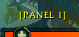
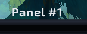

### Aura Icon Setup

Now for the settings. These look like a lot at first, so I'll go over them bit by bit.

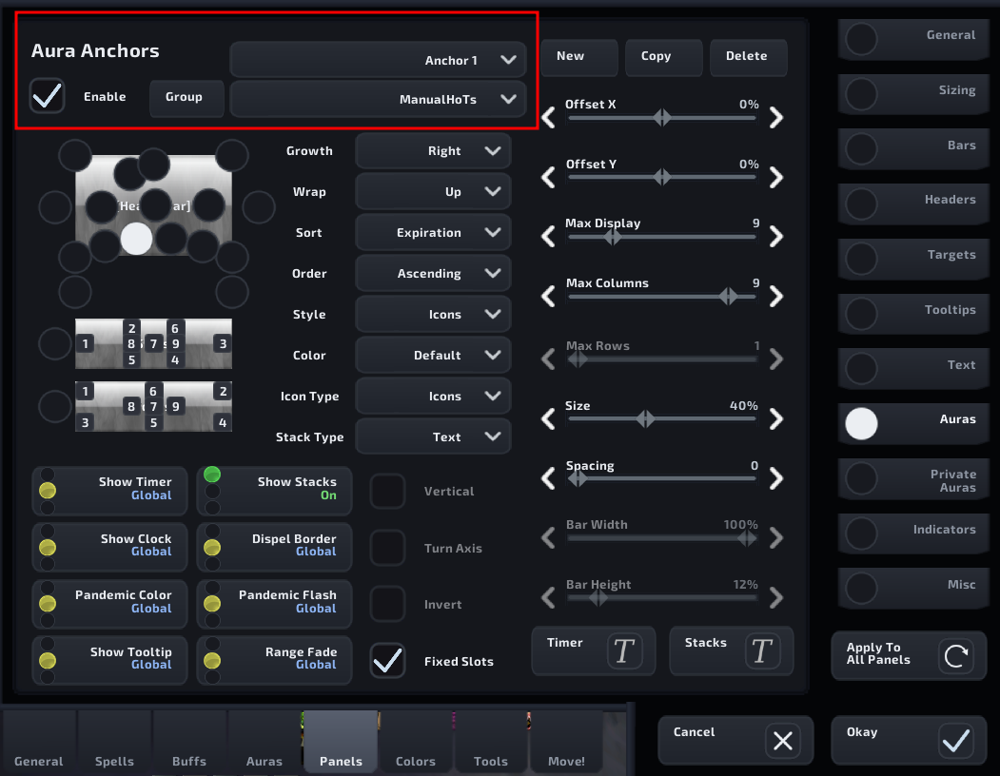

Here, you can enable or disable an anchor to toggle its icons showing. (Note that this doesn't affect debuff or custom colors.)

Use the `Anchor`-dropdown to choose which Anchor to work on. Each Anchor can hold one of your [Aura Groups](#which-auras-to-track-auras--groups). 

The dropdown right below lets you choose which Aura Group to display on this Anchor, with the `Group`-button taking you to the selected Aura Group's edit page.

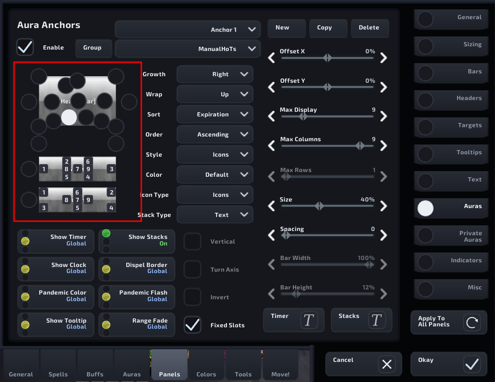

With these buttons, you can choose where on your frames this Anchor's Aura Group shows up.

If you pick a spot from the top example bar, your auras will show up in a line starting at that spot. Choose one of the presets below it if you prefer a setup where each icon shows up in a different corner of your frames.

I recommend you never choose the same spot for two Anchors, as this will make them overlap.

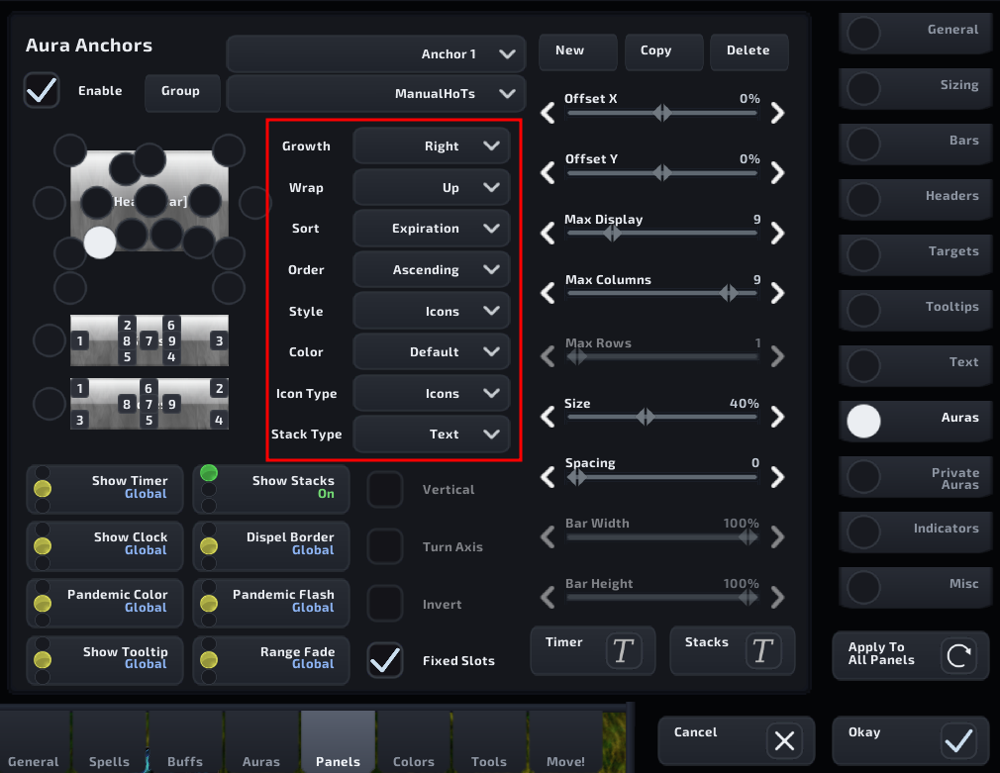

These dropdown menus let you choose exactly how your icons are going to show up. Let's go over each one.

<u>Growth:</u> This decides, which direction the icons grow in, starting from the anchor point. I.e. when choosing "right", the second icon appears to the right of the first icon.

<u>Wrap:</u> Choose where icons should start again, after the number set with the 'Max Columns`-slider is reached. I.e. choosing "up" combinded with "Growth: Right" will make your auras start a second row on top of the first row after reaching Max Columns.

<u>Sort:</u> Choose how a filter-type Aura Group's icons should be sorted.

<u>Order:</u> Choose whether the sorting order should be applied in ascending or descending order.

<u>Style:</u> Choose whether you'd like the Auras here to show up as icons or bars (similar to the old HoT bars). More about Aura Bars [here](#aura-bar-setup).

<u>Color:</u> Choose if Bar Colors (for Aura Bars) Should have their default color (set in [Auras → Colors](#global-defaults-colors--auras) or [per spell for filter-type groups](#list-type-auras-add-individual-auras)), dispel colors or class colors.

<u>Icon Type:</u> Use the default icon, a glossy or flat texture, or no icon at all (helpful for bars).

<u>Stack Type:</u> Choose if you want stacks to display as numbers or triangles.
<!-- Didn't Blizz break that? eh -->

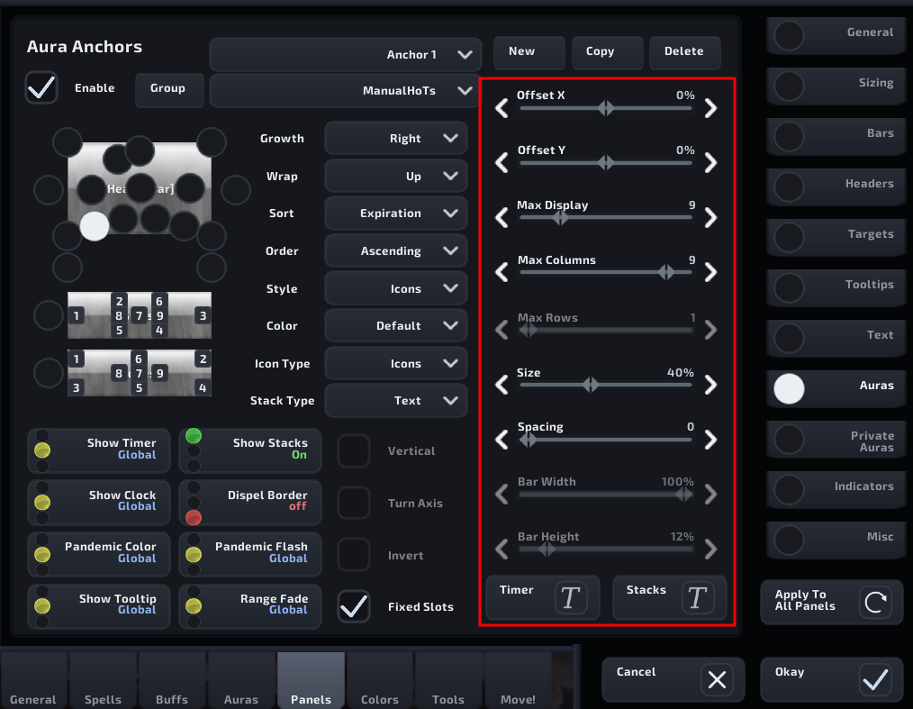

Now for these sliders.

<u>Offset X:</u> Move the anchor point to the right and left, based on your chosen spot from the radio buttons.

<u>Offset Y:</u> Move the anchor point up and down, based on your chosen spot from the radio buttons.

<u>Max Display:</u> Choose how many Auras you want to display on this anchor. This can be helpful when you don't want to see a million debuffs on your frames in PvP.

<u>Max Columns:</u> Choose how many icons can be in one row before your "Wrap" setting kicks in.

<u>Max Rows:</u> If you're using one of the two non-linear Anchors, having more than 9 Auras on one of the anchors won't show all of them by default. Set this to 2 or higher if you'd like to see the 10th icon next to the first, the 11th next to the second, and so on.

<u>Size:</u> Controls the size of your icons. This is relative to the height of your frames, so 40% will equal 40% of the height of your health bar.

<u>Spacing:</u> Controls how much space there is in between icons.

<u>Bar Width/Height:</u> These will be discussed more [in the Aura Bar setup](#aura-bar-setup).

<u>Timer:</u> Customize the font, size and position of timers on your icons.

<u>Stacks:</u> Customize the font, size and position of stack counters (if Stack Type is set to text) on your icons.

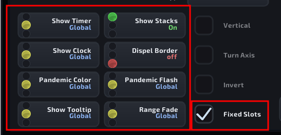

These tri-state buttons are used to override the defaults set in [Colors -> Auras](#global-defaults-colors--auras) per-anchor. What they do is explained in that section. `Global` leaves them to the default set there, whereas `On` or `Off` overrides this default.

`Fixed Slots` decides, whether icons stick to the spots they appear in on your frame, or collapse when one expires. To show what this means:

<u>Fixed Slots enabled:</u>

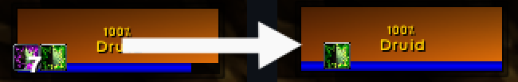

<u>Fixed Slots disabled:</u>

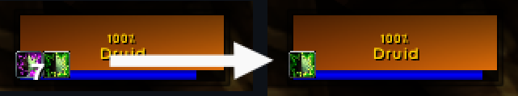

### Aura Bar Setup

As mentioned earlier, you can set an Anchor up to display all its Auras as bars.

To do this, choose `Bars` from the `Style`-Dropdown. 

If you want to configure only specific spells to show as bars, make a new anchor for them and create a [List-Type Aura Group](#list-type-auras-add-individual-auras) to anchor here. This also lets you choose custom colors for each spell's bar.

If you prefer your bars with no icons, choose `No Icon` from the `Icon Type`-Dropdown.

Additionally, I recommend checking `Fixed Slots` for this Anchor, so as to not have bars jumping around on your frames.

For this guide, I'll use a filter-type Aura Group with icon colors set to pink for Rejuvenation and Green for Regrowth, which overwrite my default bar color (which is set in [Colors → Auras](#global-defaults-colors--auras)).

When you first turn your anchor into bars, you might notice that the sizing is all over the place. This is because for bars, the `Size` slider behaves differently. For horizontal bars, the icon size is controlled by the `Bar Height`-slider, for vertical bars, `Bar Width` controls this.

Okay, now to customize how they look. The easiest setup is to have the first one appear at the top of the health bar, with the second one underneath it.

For this, choose an anchor point towards the top of your frame, and set `Growth` to `Down`, creating something like this:

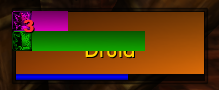

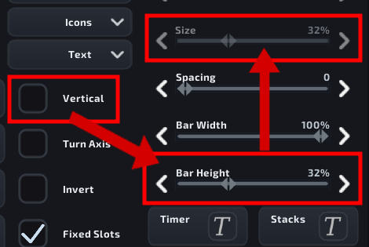

Surprise, for vertical bars, check `Vertical`. You'll likely want to set `Growth` to `Left` or `Right`, so your bars show up next to each other:

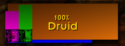

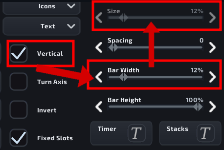

There's some more things you can do with these bars, though.
First, let's look at `Invert`. Per default, your bars start out full and grow shorter over time. Using invert, the opposite is true:

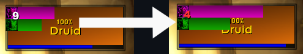

Instead of inverting the bar, you can also flip it horizontally (or vertically for a vertical setup, of course) using `Turn Axis`:

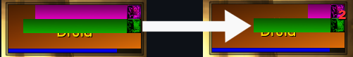

Combinations of these options are, of course, also possible, so have fun experimenting!

## Global Defaults: Colors → Auras

In Colors → Auras, you can set the defaults for your Anchors.

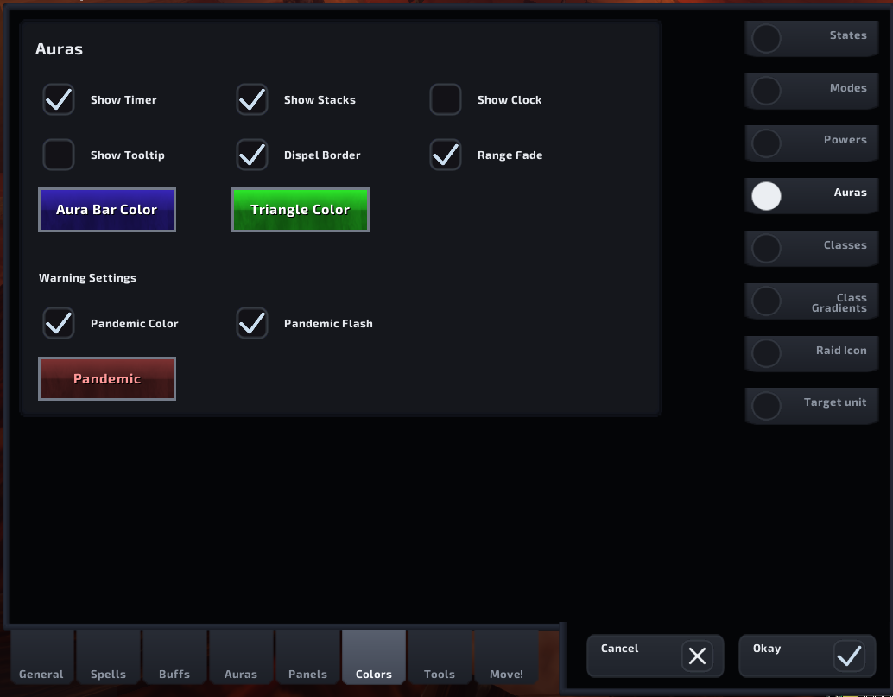

<u>Show Timer:</u> Shows a little timer number on the spell icon. Per default, this timer appears when 10 seconds are left. This can be customized in the [spell-specfic settings](#list-type-auras-add-individual-spellshots).

<u>Show Stacks:</u> Toggles showing the amount of stacks on the Aura icons.

<u>Show Clock:</u> Toggles the clock animation on expiring spells.

<u>Show Tooltip:</u> Toggles tooltips on hovering over Aura icons.

<u>Dispel Border:</u> Toggles a dispel-colored border around aura icons.

<u>Range Fade:</u> Toggles the option for Aura icons to either fade out when a unit is out of range, or keep them opaque at all times.

<u>Aura Bar Color:</u> Changes the default color and opacity for [bar-style anchors](#aura-bar-setup). This can be overwritten in the [spell-specific settings](#list-type-auras-add-individual-spellshots).

<u>Triangle Color:</u> Changes the default color for the triangle-style stack display. 

<u>**Pandemic settings** apply to Retail only, since this isn't a mechanic in Forever, so Blizzard doesn't give addons the tools for this. </u>

<u>Pandemic Color</u> will tint Aura icons (or bars) your chosen color when the duration is below ~4 seconds.

Using <u>Pandemic Flash</u> will make the Aura quickly fade in and out during this same time window.

<u>**Order of Precedence:**</u>

Spell-specific settings you make within an Aura Group in Auras → Groups will take priority over the settings you make for an anchor in Panels → Auras. 

Any settings you make in Panels->Auras will take priority over Colors → Auras.

## What about ignoring spells?

The restrictions Blizzard put in place only allow us to track B**uffs on friendly units** and **Debuffs on hostile units** via Spell ID (so in the form of a [List-Type Aura](#list-type-auras-add-individual-spellshots) or a [Bouquet](#what-about-bouquets)). The same thing applies to ignoring spells. 

So, unfortunately, ignoring specific Debuffs on your allies is a thing of the past. On the other hand, ignoring Debuffs on hostile units' frames is possible! 

## What is that Panels → Private Auras tab?

A relic of worse times shaped by guess-based dispels. 

Jokes aside, the only things that show up on there as of S2 of Midnight are some fixates and the soak at the last boss of AoF. Make sure it's set to a reasonable size so you don't get jumpscared by giant fixate icons, or feel free to disable it outright.

What's on there for Forever? Let's find out together, this will be updated when we know more!

## What about Bouquets? 

Bouquets still work, though some validators are no longer available due to the restrictions put in place by Blizzard. Invalid or no longer working bouquet entries shouldn't cause errors, but degrade gracefully.

Aura entries in bouquets follow the same tracking rules as list-type aura groups: only helpful auras on friendly units and harmful auras on hostile units.

Aura Groups (no matter if filter-type or list-type) can be put into Bouquets using the `Flag: Aura Group Active` flag. You can then select the group from the bottom `Group`-dropdown.

<!-- ## Common Setup Examples & Special Cases

These are some examples of groups/common setups for you to just copy the settings from. -->

<!--wieso tu ich mir das an lmao-->