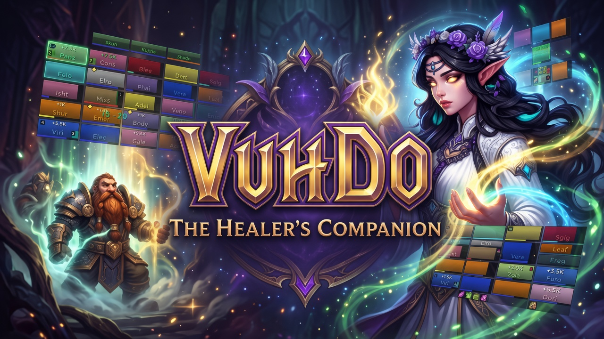

**VuhDo** is a raid-frame and click-heal addon for World of Warcraft. Use the sections below to find helpful guides, usage information and FAQs. The list in the right sidebar is the full table of contents.

## General

### [[VuhDo FAQ|VuhDo-FAQ]]

Answers for **Retail** and **Forever** e.g. class-colored bars, tracking HoTs, debuff icons, and other common setup questions.

### [[VuhDo Classic FAQ|VuhDo-Classic-FAQ]]

Answers specific only to **Classic** flavors e.g. spell ranks in bindings, spell trace limits, and absorb/shield tracking.

### [[VuhDo Slash Commands|VuhDo-Slash-Commands]]

Usage information for every `/vd` and `/vuhdo` subcommand.

## Guides

### [[VuhDo Auras Guide (Forever and Retail)|VuhDo-Auras-Midnight-and-Forever]]

Customize HoTs and debuffs under Midnight and Forever e.g. aura groups, anchors, filters, colors, and more.

### [[VuhDo Custom Flags|VuhDo-Custom-Flag-Bouquet-Validators]]

Write custom Lua conditions for bouquet validators, with examples and the unit info schema.

### [[VuhDo Options Skinning Guide|VuhDo-Options-Skinning-Guide]]

Register custom visual themes for VuhDo Options (textures, colors, and API).

## Community

- [Discord](https://discord.gg/57en44E) — support, discussion, and updates
- [CurseForge](https://www.curseforge.com/wow/addons/vuhdo) — downloads and release notes
- [GitHub issues](https://github.com/vuhdo-io/VuhDo/issues/new/choose) — bug reports and feature requests
- [wago.io](https://wago.io) — shareable profiles, key layouts, and bouquets

## Wiki

[[Contributing to the Wiki|Contributing-to-the-Wiki]] — pages can be edited only via pull request; the wiki is published from the `wiki/` folder on the `midnight` branch.